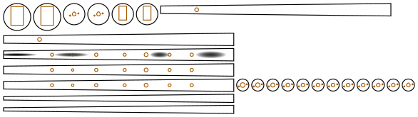

# Uilleann chanter

**[← All projects](https://gernreich.github.io/)**

<!-- readme-only -->
**[Read the writeup](https://gernreich.github.io/uilleann-chanter/)** ·
**[Turn it in 3D](https://gernreich.github.io/uilleann-chanter/)**

<!-- page-only **[Read the README](https://github.com/Gernreich/uilleann-chanter)** · **[Turn it in 3D on a page of its own](turn.html)** -->

<!-- page-only <iframe src="turn.html?embed" title="The uilleann chanter as solid parts you can drag to turn and pull apart: a long, darker, tapering square tube of strips with seven holes along the front, a narrow round tenon and a wider collar at the narrow end, and a round foot at the wide end" style="width:100%;height:560px;border:0"></iframe> -->

An uilleann pipe chanter in 3mm plywood: Craig Fischer's square chanter (1997), cut on
a laser. Its conical bore is a tapering square made from four flat strips: a back, two
sides and a lid. Fischer's article is
[Make a Square Uilleann Pipe Chanter](https://www.daye1.com/bagpage/makepipe/squint1.html),
hosted by David Daye. This generator keeps his bore, his hole positions and his
starting drill sizes, and engraves his starting bore enlargements. Tuning is still done by hand, his way.

**It has not been cut or played yet.**

<table>
<tr>
<td align="center"><a href="cut-files/uilleann-chanter-sheet1-cut-files.svg"></a></td>
</tr>
<tr>
<td align="center"><sub>the whole chanter on one 587 × 166mm sheet</sub></td>
</tr>
</table>

Built for **[LaserMadeMusic](https://www.youtube.com/@LaserMadeMusic)**.

**[The rest of the build files](https://gernreich.github.io/lasermademusic.html)** — every instrument,
generator and tool, indexed.

**[Download everything as a ZIP](https://github.com/Gernreich/uilleann-chanter/archive/refs/heads/main.zip)**

## The chanter

| | |
|---|---|
| Bore | Fischer's square cone, 3.7mm square at the top to 11.5mm at the sole over 365mm, matching a Quinn chanter's cross-section. The strips start 42mm down at 4.60mm and end at 11.50mm |
| Back | 2 layers glued face to face, 6mm, with the thumb's hole (back D) |
| Sides | 1 layer each, exactly as wide as the bore, glued on the back's face |
| Lid | 3 layers, 9mm, with the seven front holes. Fischer asks for at least 7mm, because a hole's depth sets its note. A deeper hole plays flatter, and you tune by opening holes, so the lid starts deep. Thin it over the holes from outside if a note won't come up |
| Dishes | Fischer's four starting bore enlargements, engraved in greyscale into the lid's bore layer (darker is deeper, black 1.5mm): 30–90mm 1.5mm deep, 112–162mm, 247–275mm and 311–355mm 1.2mm deep. Each is an oval dish, never closer than 0.3mm to the edge of the bore's face, so none runs under a side's glue line. The 30–42mm part sits above the strips and is cut instead, as a lobe on the front of 4 plates' bore holes |
| Tenon | 12 round plates, 17mm across (`--tenon=` for your stock). The reed's seat steps down from 6.8mm to Fischer's 5.16mm (13/64in) throat. Ream it smooth |
| Collar | 2 plates 30mm across, the stop Fischer suggests. The tenon and collar press-fit on two 2mm pins |
| Socket | 2 plates the strips' top stands in. Leave them dry while you tune, and glue them when the lid goes on |
| Foot | 2 plates 38mm across round the sole, the tube Fischer suggests to hold the glue lines |
| Sheet | one 587 × 166mm sheet of 3mm ply, 25 parts |

| Hole | Down from the top | Strip | Cut | Open up to about |
|---|---|---|---|---|
| back D | 92.5mm | back | 5.56mm (7/32in) | 7.14mm (9/32in) |
| C# | 110mm | lid | 4.37mm (11/64in) | 5.56mm (7/32in) |
| B | 139mm | lid | 3.57mm (9/64in) | 5.56mm (7/32in) |
| A | 172mm | lid | 4.76mm (3/16in) | 7.14mm (9/32in) |
| G | 212mm | lid | 4.37mm (11/64in) | 4.37mm (11/64in) |
| F# | 242mm | lid | 5.56mm (7/32in) | 7.14mm (9/32in) |
| E | 275mm | lid | 4.37mm (11/64in) | 4.37mm (11/64in) |
| E flat | 306mm | lid | 4.76mm (3/16in) | 6.35–7.14mm (1/4–9/32in) |

## Building it

1. Glue each strip's layers face to face, with drill bits through the holes to line them up.
2. Glue the two sides onto the back's bore face, flush with its edges.
3. The dishes are engraved when you cut, before the cuts: the images, in Grayscale mode in xTool
   Creative Space. Depth in ply doesn't follow the grey evenly, and glue lines burn
   differently from wood, so on scrap from the same sheet, set black to 1.5mm.
   Burn shallow rather than deep: gouging more out is easy, putting wood back isn't.
   Fischer's sketch draws the first dish at 58–96mm, not the 30–90mm his text gives.
   The text is kept here (`DISHES` in the generator).
4. Hold the lid on with silicone. The tenon and collar plates' pins aren't opposite
   each other, so each plate goes on one way, with its lobe toward the lid.
5. Slide the socket on dry, press the tenon and collar together on their pins, and tune
   by Fischer's method: open the holes from the high notes down, and lift the lid to
   change the bore.
6. When it plays, glue the lid, the socket and the foot, and seal the seams and the
   bore with shellac.

The reed is Fischer's: a wide-headed reed on a tubing staple. His article covers that too.

## Regenerating

```
python3 uilleann_chanter.py --no-write          # the checks
python3 uilleann_chanter.py --out=cut-files     # the sheet
python3 uilleann_chanter.py --plate=2.9 --kerf=0.18 --tenon=18 --out=cut-files
```

It imports `../practice-chanters` for the sheet packer and the SVG writer.

## Credit

The design is Craig Fischer's: the square bore, the hole positions and drill sizes, the
bore enlargements, the tuning method and the reed are all from his article
[Make a Square Uilleann Pipe Chanter](https://www.daye1.com/bagpage/makepipe/squint1.html)
(© 1997 Craig Fischer), hosted by David Daye, who also sells reeds for it. Read the
article for the tuning and the reed; this repository only turns his measurements into
cut files.
